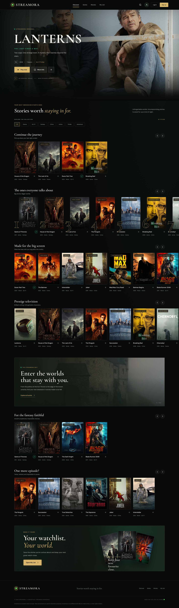
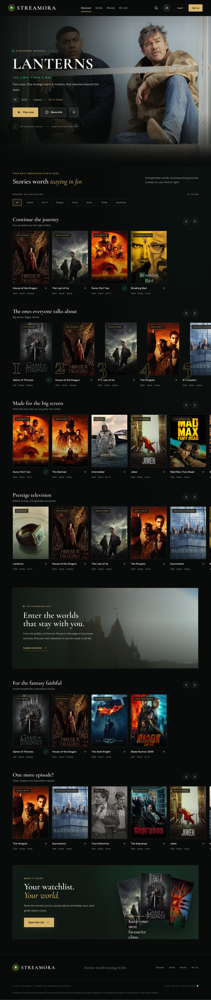
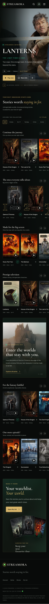

# Streamora — Discover. Explore. Stream. 🎬

Streamora is a modern streaming platform UI/UX design created to deliver a cinematic and intuitive content discovery experience. Featuring a premium dark interface, immersive visuals, and carefully structured layouts, Streamora brings movies and series together in one place.

The project explores how a streaming platform can present entertainment content through engaging visuals, organized browsing sections, and responsive layouts for desktop, tablet, and mobile devices.

## 🔗 Figma Design

Explore the complete UI/UX design and visual direction of Streamora.

### [🎨 View Streamora on Figma →](https://www.figma.com/design/dngxx9PFz33Y3mDdPK92lG/Streamora-Streaming-Platform?node-id=5-5674)

## 🖥️ Design Previews

### Desktop UI



### Tablet UI



### Mobile UI



## ✨ Features

- **Cinematic Hero Section:** Highlights featured content with immersive backgrounds, prominent titles, and descriptive information.
- **Content Discovery:** Organizes movies and series into visually engaging sections.
- **Movies & Series:** Provides dedicated navigation for exploring different types of content.
- **Featured Content Cards:** Showcases movie and series artwork alongside relevant information.
- **Genre-Based Browsing:** Helps users discover content by category and genre.
- **Title Details:** Presents information such as descriptions, release years, ratings, genres, and duration.
- **Search Interface:** Provides a dedicated interface for finding content.
- **My List:** Includes a watchlist interface for organizing saved titles.
- **Content Preview:** Includes a preview interface for exploring selected titles.
- **Responsive Layouts:** Includes dedicated desktop, tablet, and mobile designs.
- **Consistent Navigation:** Maintains a unified navigation experience.
- **Cinematic Visual Identity:** Combines a dark interface, elegant typography, and subtle accent colors.

## 🛠️ Tool Used

| Tool | Purpose |
|---|---|
| Figma | UI/UX design, layout organization, and visual presentation |

## 🎨 Design System

Streamora follows a dark, cinematic visual direction inspired by modern streaming platforms.

### Color Palette

| Color | Hex Code | Purpose |
|---|---|---|
| Deep Charcoal | `#0D0D0D` | Primary background |
| Dark Surface | `#171717` | Cards and secondary surfaces |
| Muted Gold | `#C6A15B` | Highlights and visual accents |
| Soft White | `#F5F5F5` | Primary text |
| Muted Grey | `#A0A0A0` | Secondary text and descriptions |
| Subtle Green | `#7A9B76` | Supporting accent |

*Note: These are representative palette values. Replace them if your actual Figma colors differ.*

### Typography

- **Cormorant Garamond:** Expressive headings and cinematic typography.
- **DM Sans:** Navigation, descriptions, and interface text.

The design emphasizes contrast, clear typography, immersive imagery, consistent spacing, and a premium browsing experience.

## 📂 Project Structure

```text
Streamora-Streaming-Platform-UI/
├── README.md
├── streamora-desktop.png
├── streamora-tablet.png
└── streamora-mobile.png
```

The PNG files provide visual previews of the three responsive layouts. The complete design can be explored through the Figma link above.

## 💡 Design Approach

Streamora focuses on presenting entertainment content through a visually rich and organized interface. The dark visual theme allows movie artwork to stand out, while structured content sections support intuitive discovery.

The responsive design approach explores how a consistent visual identity can be maintained across desktop, tablet, and mobile layouts while adapting the presentation to different screen sizes.

## 👨‍💻 Credits

**Designed by:** Mohammad Zaid

**Project Type:** UI/UX Design — Responsive Streaming Platform

Created as part of a college project to explore interface design, visual hierarchy, responsive layouts, and modern streaming-platform experiences.

---

**Streamora — Discover. Explore. Stream.**
